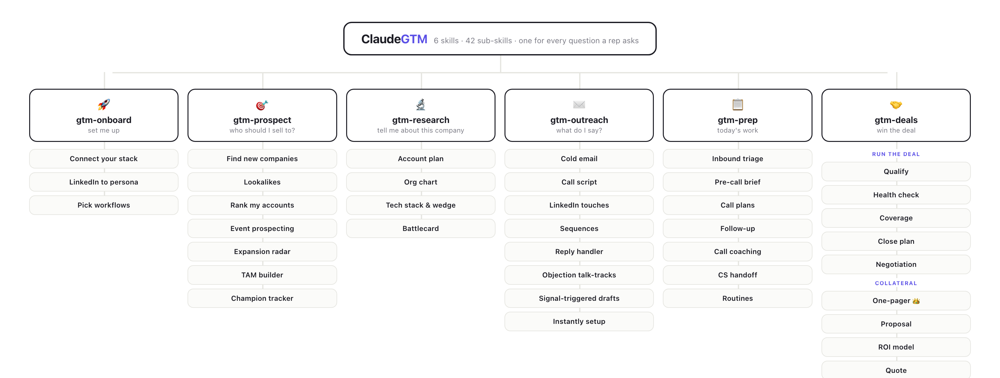
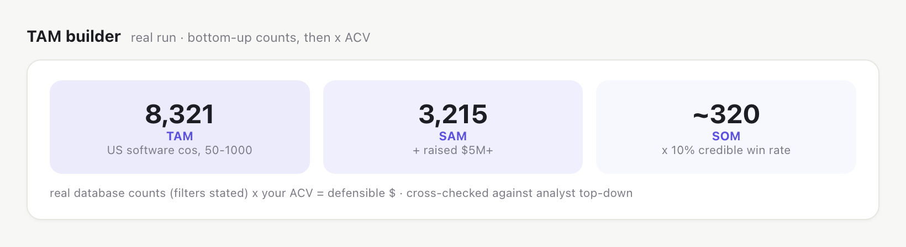
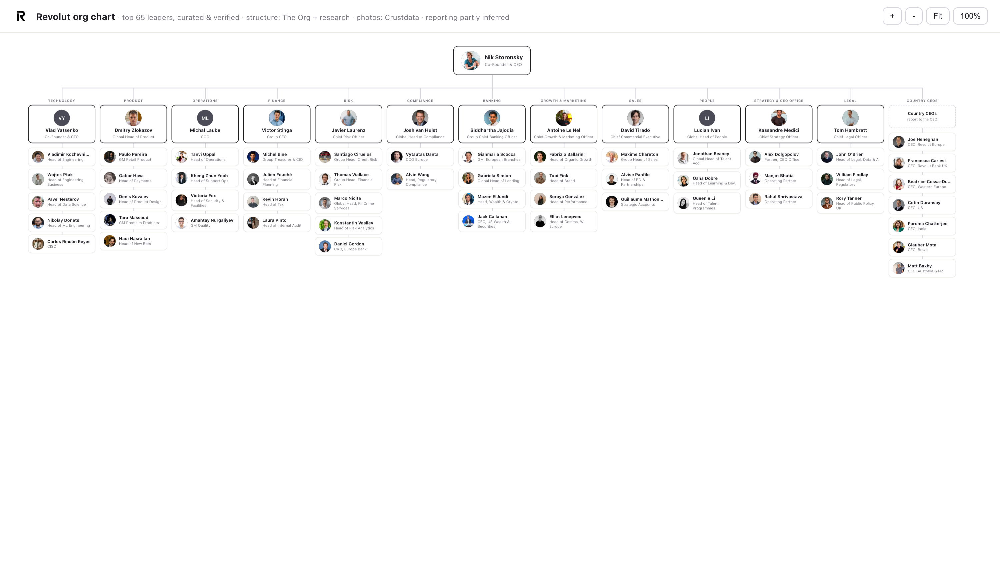
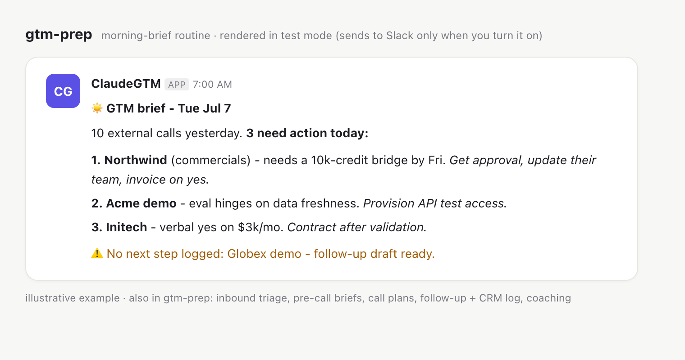

# ClaudeGTM

The GTM skills the Crustdata team uses, packaged so anyone can install them.

Six skills, each one mapped to something a rep does every day: find who to sell to, research them, write the outreach, prep for calls, work the deal. You install them into Claude and talk to it in plain English. They plug into whatever CRM, call recorder, and sequencer you already use.

## The six skills

| Skill | The question it answers |
|---|---|
| 🚀 **gtm-onboard** | set me up (stack -> LinkedIn -> persona -> pick workflows) |
| 🎯 **gtm-prospect** | **who should I sell to?** - net-new lists, lookalikes, rank my accounts, event lists, expansion whitespace, TAM, champion tracker |
| 🔬 **gtm-research** | **tell me about this company** - account plan (external + your CRM/call/Slack history), org chart, tech stack & wedge, battlecard |
| ✉️ **gtm-outreach** | **what do I say?** - cold email/call/LinkedIn, full sequences, replies, objections, signal-triggered drafts, Instantly campaign setup |
| 📋 **gtm-prep** | **today's work** - score inbound, prep any call, follow up + log it, coach my call, CS handoff, morning-brief routine |
| 🤝 **gtm-deals** | **win the deal** - MEDDICC from real calls, risk, coverage, close plan, negotiation, the one-pager 👑, ROI, quote, forecast, pipeline, lost-deal analysis |

It follows the order you actually work in: **prospect -> research -> outreach -> prep -> deals.**



## Every skill, every sub-skill, real outcomes

### 🚀 gtm-onboard - set me up

- **Connect your stack** - name your CRM, calendar, email, recorder, sequencer, Slack. Everything skippable; skipped tools just go draft-only.
- **LinkedIn to persona** - paste one URL; Crustdata builds who you are, what you sell, your ICP and your writing voice. No forms.
- **Pick workflows** - choose which of the 5 skills to set up. Routines and watchers stay opt-in.

### 🎯 gtm-prospect - who should I sell to?

- **Find new companies** - net-new list from an ICP, built iteratively: validate filters, search, inspect the top 10, refine 2-4 rounds.
- **Lookalikes** - name your best customers; their shared traits become the filters. Seeds and existing customers excluded.
- **Rank my accounts** - your book, territory or pasted CSV, scored by live timing signals. *(live-tested)*
- **Event prospecting** - scrape the real roster from the event page, filter to ICP, build the meet-list.
- **Expansion radar** - four surfaces swept per existing customer: new money, new people, new ground, warm paths.
- **TAM builder** - bottom-up: real database counts (filters stated) x your ACV, cross-checked top-down. *(real database counts)*
  
- **Champion tracker** - people who used your product at a customer and just changed jobs. Optional weekly watcher. *(live-tested)*

### 🔬 gtm-research - tell me about this company

- **Account plan** - the external sweep (data, jobs, news, their posts) PLUS your internal history: CRM deals, call transcripts, Slack, email.
- **Org chart** - real reporting lines from published org sources, photos and titles from Crustdata, curated by hand. *(live demo: Revolut, public data)*
  
- **Tech stack & wedge** - job posts reveal the real stack; classify each tool as displace / complement / gap and phrase the opening.
- **Battlecard** - honest strengths, real gaps, landmine questions, traps to avoid. Current (last 90 days), not folklore.

### ✉️ gtm-outreach - what do I say?

- **Cold email** - under 90 words, one real hook, one ask, the rep's voice. Humanizer gate on everything.
- **Call script** - opener, permission line, reason tied to the hook, objection branches, voicemail.
- **LinkedIn touches** - connect note (no pitch), value-first DM, graceful break-up.
- **Sequences** - multi-channel cadence with a different angle per touch, every touch written out.
- **Reply handler** - classify the incoming reply, draft the advance, never argue with a hard no.
- **Objection talk-tracks** - diagnose the real objection first, then acknowledge, reframe, prove, re-ask.
- **Signal-triggered drafts** - a fired signal (raise, new exec, champion moved) becomes a dated, relevant touch.
- **Instantly setup** - the whole campaign built from your list: leads CSV, sequence loaded, schedule set - created PAUSED. You press start.

### 📋 gtm-prep - today's work

- **Inbound triage** - close-probability % scored against your ICP and your actual closed-won pattern, reasons shown.
- **Pre-call brief** - company + person + your history with them, one screen, with an opener you can actually say.
- **Call plans** - discovery question plan (MEDDICC-mapped), demo flow, or negotiation prep.
- **Follow-up** - recap email from the real transcript in your voice + CRM note and tasks, written only after your yes.
- **Call coaching** - talk ratio, question quality, timestamped moments, and the ONE habit to fix.
- **CS handoff** - the promise the deal was sold on, on paper: metrics, milestones, risks, open commitments.
- **Routines** - morning brief, inbound bot, EOD nudge. Test-rendered like this; posts to Slack only when you turn it on. *(illustrative)*
  

### 🤝 gtm-deals - win the deal

- **Qualify (MEDDICC)** - every field cites a transcript quote or CRM note; gaps come with the exact question to close them.
- **Health check** - risk verdict from evidence (next step scheduled? single-threaded? dates slipping?) - every risk gets a fix.
- **Coverage** - the buying committee vs who you have actually engaged, with the warm path to each gap.
- **Close plan (MAP)** - reverse-timeline from the buyer's go-live using the buyer's process, owners and dates on both sides.
- **Negotiation prep** - every give trades for a get; floor, walk-away, BATNA, procurement counters.
- **One-pager 👑** - one page, ~120 words, your branding, the buyer's own words. Screenshot-reviewed, PDF-ready.
- **Proposal** - same truth rules, more sections, docx/pptx.
- **ROI model** - their numbers from the calls, conservative + base case, editable xlsx.
- **Quote** - good/better/best from your price book only. Never invented prices.
- **Case-study match** - the closest real proof wins; famous-but-wrong gets flagged.
- **Pipeline review** - segment the book, flag happy-ears deals, output this week's highest-leverage moves.
- **Forecast** - commit / best case / pipeline categorized by evidence, not CRM stage defaults.
- **Lost-deal analysis** - where deals actually die (transcripts over loss labels) and the systemic fixes.

## Setup

1. Drop `skills/` into `.claude/skills/` (or run `./install.sh` to symlink for development).
2. Run **`/gtm-onboard`** once: connect your stack (everything skippable), paste your LinkedIn (Crustdata builds your persona), pick your workflows.
3. Talk in plain English: *"build me a list of Series B fintechs hiring AEs"*, *"org chart for Revolut"*, *"prep my 2pm"*, *"MEDDICC the Acme deal"*, *"make a one-pager for the Acme deal"*.

## Repo layout

```
claude-gtm-skills/
├── README.md
├── install.sh                      # symlink skills for local dev
├── .claude-plugin/plugin.json      # installable as a plugin
├── config/gtm-config.example.md    # the composable backbone (onboarding writes the real one)
├── examples/                       # real generated artifacts (org charts, one-pagers)
└── skills/
    ├── gtm-onboard/
    ├── gtm-prospect/
    ├── gtm-research/               # + orgchart-playbook.md
    ├── gtm-outreach/
    ├── gtm-prep/
    └── gtm-deals/                  # + onepager-playbook.md
```


# Crustdata Skills

Open-source skills for [Claude.ai](https://claude.ai), [Claude Desktop](https://claude.ai/download), and [Claude Code](https://docs.anthropic.com/en/docs/claude-code/skills) — powered by [Crustdata](https://crustdata.com)'s real-time B2B data APIs. Each skill is a ready-to-use AI workflow for sales, recruiting, and growth tasks. No coding required.

## Skills

| Skill | What it does |
|-------|-------------|
| [Email Enrichment](./email-enrichment/) | Turn a list of names into verified business and personal emails |
| [Candidate Sourcing](./candidate-sourcing/) | Go from "I need to hire for role X" to personalized Gmail drafts ready to send |

*More skills coming soon.*

---

## Getting started

Every skill works with **Claude.ai** (web), **Claude Desktop** (macOS/Windows app), and **Claude Code** (CLI). Pick your platform:

### Claude.ai — web, no install

1. **Get a Crustdata API key** at [crustdata.com](https://crustdata.com)
2. **Add Crustdata** — go to [Settings → Connectors](https://claude.ai/settings/connectors) → click "Add custom connector" → paste `https://mcp.crustdata.com/mcp` → click "Add". ([Step-by-step guide with screenshots](https://support.anthropic.com/en/articles/11175166-getting-started-with-custom-integrations-using-remote-mcp))
3. **Connect Gmail** (for skills that send emails) — Gmail is already listed in your Connectors. Just click "Connect" next to it
4. **Upload a skill** — download the `.skill` file from [Releases](https://github.com/crustdata/skills/releases) and upload it to your project

### Claude Desktop — macOS / Windows app

1. **Get a Crustdata API key** at [crustdata.com](https://crustdata.com)
2. **Add Crustdata** — open Settings → Connectors → "Add custom connector" → paste `https://mcp.crustdata.com/mcp` → click "Add". Same flow as Claude.ai. ([Step-by-step guide](https://support.anthropic.com/en/articles/11175166-getting-started-with-custom-integrations-using-remote-mcp))
3. **Connect Gmail** — find Gmail in your Connectors list and click "Connect"
4. **Upload a skill** — download the `.skill` file from [Releases](https://github.com/crustdata/skills/releases) and upload it to your project

### Claude Code — CLI for developers

**1. Add Crustdata** to your MCP config:

```json
{
  "mcpServers": {
    "crustdata": {
      "url": "https://mcp.crustdata.com/mcp",
      "headers": {
        "Authorization": "Bearer YOUR_API_KEY"
      }
    }
  }
}
```

Get your API key at [crustdata.com](https://crustdata.com).

**2. Clone this repo:**

```bash
git clone https://github.com/crustdata/skills.git
```

---

## Email Enrichment

> Bulk email finder for B2B contact enrichment. Find business emails and personal emails from a list of names, LinkedIn profiles, or a spreadsheet.

**Input:** A list of people — names, companies, LinkedIn URLs, or an .xlsx/.csv spreadsheet

**Output:** Verified business emails + personal emails, added as new columns

### Before & After

```
BEFORE:                                    AFTER:
┌──────────────┬─────────────┐             ┌──────────────┬─────────────┬─────────────────────┬──────────────────────┐
│ Name         │ Company     │             │ Name         │ Company     │ Business Email      │ Personal Email       │
├──────────────┼─────────────┤             ├──────────────┼─────────────┼─────────────────────┼──────────────────────┤
│ Pete Koomen  │ YC          │    ──►      │ Pete Koomen  │ YC          │ pete@ycombinator.com│ koomen@gmail.com     │
│ Kaushik Iska │ ClickHouse  │             │ Kaushik Iska │ ClickHouse  │ kaushik@clickhouse… │ iska.kaushik@gmail…  │
│ Topher Conway│ SV Angel    │             │ Topher Conway│ SV Angel    │ topher@svangel.com  │ —                    │
└──────────────┴─────────────┘             └──────────────┴─────────────┴─────────────────────┴──────────────────────┘
```

### How it works

1. **Resolves identities** — matches names + companies to LinkedIn profiles via Crustdata's 1B+ person database
2. **Finds business emails** — enriches profiles in batches using Crustdata's people enrichment API
3. **Finds personal emails** — uses Crustdata's web search API with smart multi-source discovery

Unlike Apollo, Hunter.io, Clearbit, ZoomInfo, People Data Labs, Coresignal, Lusha, RocketReach, Exa, or Parallel — this runs entirely inside Claude as an AI-native workflow. No GUI, no manual CSV uploads, no per-seat pricing. Just describe what you need.

### Use cases

- **Sales prospecting** — enrich lead lists with verified business emails for cold outreach
- **Recruiting** — find personal emails for engineering candidates you want to reach directly
- **Investor outreach** — build contact lists for fundraising from conference attendee lists
- **Event follow-up** — turn a spreadsheet of people you met into actionable contacts

### Try it

Just ask Claude: *"Find emails for these people: [paste your list]"*

[Full documentation and evals →](./email-enrichment/)

---

## Candidate Sourcing

> AI-powered candidate sourcing for founders and hiring managers. Find engineers, verify their LinkedIn profiles, enrich emails, write personalized outreach, and create Gmail drafts — all in one workflow.

**Input:** A role description — what you're hiring for, what technical problems matter, any target companies or communities

**Output:** Gmail drafts ready to send, each with a personalized opener referencing the candidate's specific work

### Before & After

```
YOU SAY:                                   YOU GET:
┌─────────────────────────────────┐        ┌──────────────┬───────────┬─────────────────────────────────────┬──────────┐
│ "Find 5 ML engineers who've     │        │ Candidate    │ Company   │ Why them                            │ Status   │
│  published on RAG. Prioritize   │  ──►   ├──────────────┼───────────┼─────────────────────────────────────┼──────────┤
│  startups over FAANG. Draft     │        │ Jane Chen    │ Cohere    │ First author on RAG benchmark paper │ Draft ✓  │
│  outreach for our Founding ML   │        │ Raj Patel    │ Pinecone  │ Built RAG eval toolkit (2.3K stars) │ Draft ✓  │
│  Engineer role."                │        │ Maria Lopez  │ Weaviate  │ Led vector search, MLOps speaker    │ Draft ✓  │
└─────────────────────────────────┘        └──────────────┴───────────┴─────────────────────────────────────┴──────────┘
```

### How it works

1. **Finds candidates** — searches Crustdata's 1B+ person database, arXiv, GitHub, and the web for people matching your specific criteria
2. **Verifies LinkedIn** — waterfall lookup through Crustdata, never guesses URLs (guessed URLs caused 12 errors in a real 91-person campaign)
3. **Finds emails** — business emails via Crustdata enrichment, personal emails via Crustdata web search
4. **Writes personalized outreach** — each email references the candidate's specific work, not job titles
5. **Creates Gmail drafts** — ready to review and send, with a CSV tracker for pipeline management

Unlike Juicebox, HireEZ, SeekOut, LinkedIn Recruiter, or traditional recruiters ($15-30K per hire) — you define the ranking criteria, you see every step, and you pay per use. No black-box algorithm deciding who's "best."

### Use cases

- **Seed/Series A founders** sourcing their first engineers without a recruiter
- **Hiring managers** who want to own top-of-funnel instead of waiting on recruiters
- **Technical founders** who know what "good" looks like and want to define their own ranking
- **Anyone tired of Juicebox** surfacing the same senior FAANG engineers that every other startup is pitching

### Try it

Tell Claude: *"I need to hire a [role]. Find candidates and set up outreach."*

[Full documentation and evals →](./candidate-sourcing/)

---

## Contributing

Each skill lives in its own directory:

```
skills/
├── email-enrichment/
│   ├── SKILL.md          # Skill definition (the AI reads this)
│   ├── README.md         # Human-readable docs
│   └── evals/
│       └── evals.json    # Test cases for benchmarking
└── candidate-sourcing/
    ├── SKILL.md
    ├── README.md
    └── evals/
        └── evals.json
```

## License

MIT — see [LICENSE](./LICENSE).

---

Built on [Crustdata](https://crustdata.com) — the public data layer for AI and humans.
