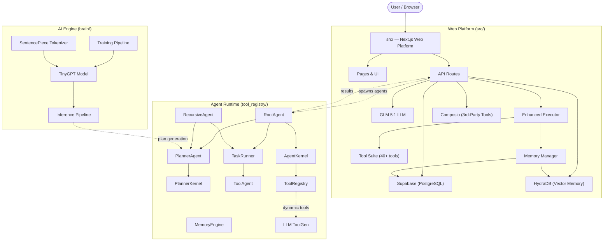
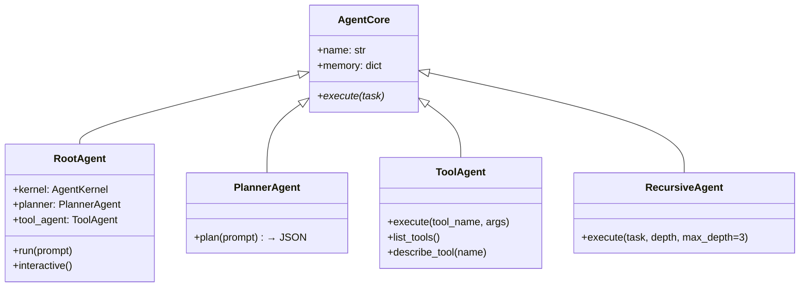
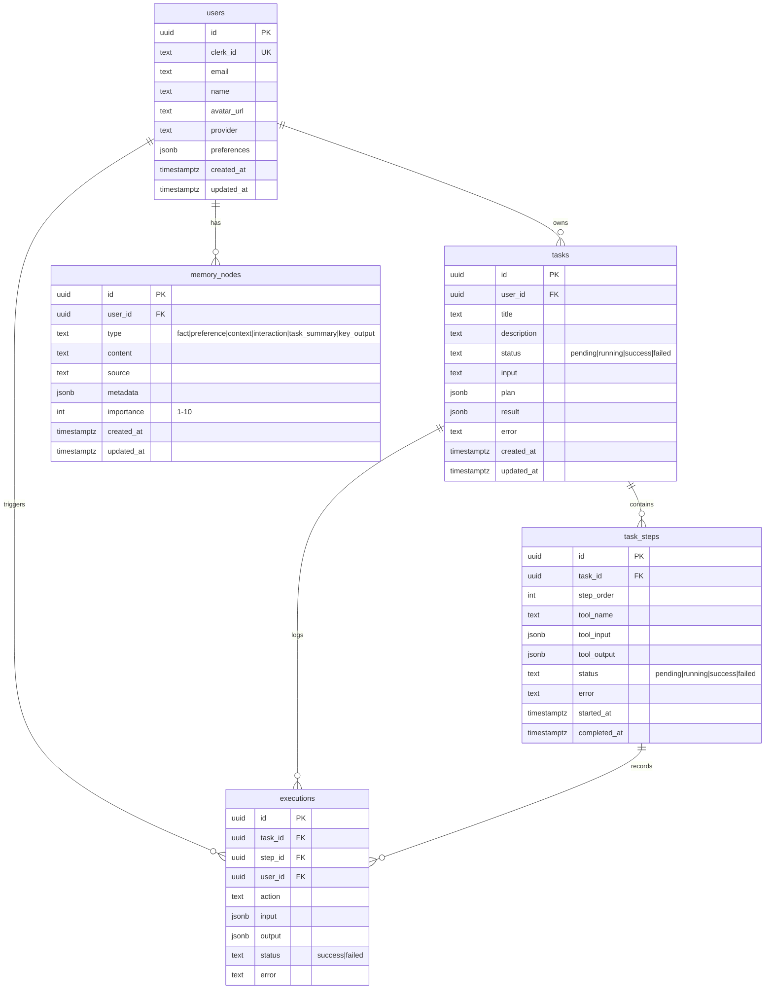

# Anymind — Project Architecture

> **Anymind (AgentOS)** is a full-stack AI agent operating system that combines a custom-trained GPT model, a pluggable Python agent runtime, and a Next.js web platform — enabling anyone on the web to spawn, manage, and interact with autonomous AI agents.

---

## Table of Contents

- [High-Level Overview](#high-level-overview)
- [System Architecture Diagram](#system-architecture-diagram)
- [Directory Structure](#directory-structure)
- [Subsystem 1 — `brain/` (The AI Engine)](#subsystem-1--brain-the-ai-engine)
  - [TinyGPT Model](#tinygpt-model)
  - [Tokenizer](#tokenizer)
  - [Training Pipeline](#training-pipeline)
  - [Inference Pipeline](#inference-pipeline)
  - [Memory (Brain-Level)](#memory-brain-level)
  - [Tools (Brain-Level)](#tools-brain-level)
  - [Core & Executor](#core--executor)
- [Subsystem 2 — `tool_registry/` (The Agent Runtime)](#subsystem-2--tool_registry-the-agent-runtime)
  - [Agent Hierarchy](#agent-hierarchy)
  - [Kernel & Orchestration](#kernel--orchestration)
  - [Planning Engine](#planning-engine)
  - [Task Execution](#task-execution)
  - [Memory Engine](#memory-engine)
  - [Tool System](#tool-system)
  - [Dynamic Tool Generation](#dynamic-tool-generation)
  - [Spawning Agents for the Web](#spawning-agents-for-the-web)
- [Subsystem 3 — `src/` (The Web Platform)](#subsystem-3--src-the-web-platform)
  - [Frontend Architecture](#frontend-architecture)
  - [Page Routes](#page-routes)
  - [API Routes (Backend)](#api-routes-backend)
  - [LLM Integration (GLM 5.1)](#llm-integration-glm-51)
  - [Enhanced Executor](#enhanced-executor)
  - [Tool Suite](#tool-suite)
  - [Third-Party Integrations](#third-party-integrations)
  - [Memory System (Web Layer)](#memory-system-web-layer)
  - [Developer Environment](#developer-environment)
  - [State Management](#state-management)
  - [Component Library](#component-library)
- [Database Schema](#database-schema)
- [Authentication & Authorization](#authentication--authorization)
- [Data Flow — End to End](#data-flow--end-to-end)
- [Tech Stack Summary](#tech-stack-summary)
- [Environment Variables](#environment-variables)
- [Scripts & Utilities](#scripts--utilities)

---

## High-Level Overview

Anymind is composed of **three major subsystems** that work together:

| Subsystem | Language | Role |
|-----------|----------|------|
| **`brain/`** | Python (PyTorch) | Custom GPT model that powers the system's AI — handles planning, reasoning, and task decomposition |
| **`tool_registry/`** | Python | Agent runtime that spawns agents as needed and exposes them to be used by anyone on the web — executes plans, manages tools, handles memory |
| **`src/`** | TypeScript (Next.js) | Full-stack web platform — the UI, API routes, database layer, and integration hub |

```
┌─────────────────────────────────────────────────────────────────┐
│                         USER (Browser)                          │
└──────────────────────────────┬──────────────────────────────────┘
                               │
                    ┌──────────▼──────────┐
                    │   src/ (Next.js)    │
                    │  Web Platform + API │
                    └──────┬───────┬──────┘
                           │       │
              ┌────────────▼─┐   ┌─▼────────────┐
              │   brain/     │   │ tool_registry/│
              │  (AI Engine) │◄──│ (Agent Runtime│
              │   TinyGPT    │   │  & Spawner)   │
              └──────────────┘   └───────────────┘
```

---

## System Architecture Diagram



---

## Directory Structure

```
agentos/
├── brain/                          # 🧠 AI Engine (Python/PyTorch)
│   ├── model/
│   │   └── tinygpt.py              #    Custom GPT transformer architecture
│   ├── tokenizer/
│   │   ├── tokenizer.py            #    SentencePiece tokenizer wrapper
│   │   ├── train_tokenizer.py      #    Tokenizer training script
│   │   ├── spm.model               #    Trained SentencePiece model
│   │   └── vocab.json              #    Vocabulary mapping
│   ├── training/
│   │   ├── config.py               #    Training hyperparameters
│   │   ├── data.py                 #    Dataset loader (AgentDataset)
│   │   ├── model.py                #    Model factory
│   │   ├── train.py                #    Basic training loop
│   │   ├── train_general_gpt.py    #    Production training script
│   │   └── agentgpt/               #    Alternative training pipeline
│   ├── inference/
│   │   ├── generate.py             #    Basic text generation
│   │   ├── generate_general.py     #    Interactive generation (SP tokenizer)
│   │   └── generate_plan.py        #    Structured plan generation
│   ├── core/
│   │   └── task_runner.py          #    Sequential plan step executor
│   ├── executor/
│   │   └── planner_executor.py     #    Full plan→execute orchestrator
│   ├── memory/
│   │   ├── planner_memory.py       #    Past plans storage
│   │   └── planner_mem.json        #    Persisted plans
│   ├── tools/
│   │   ├── tool_registry.py        #    Dynamic tool loader
│   │   ├── youtube_tools.py        #    YouTube search/info tools
│   │   └── youtube_uploader.py     #    YouTube upload tool
│   ├── data/                       #    Training datasets (JSONL, text, binary)
│   ├── utils/
│   │   ├── helpers.py              #    JSON cleaning, file I/O
│   │   └── logger.py               #    Logging
│   └── *.py                        #    Root-level training/data scripts
│
├── tool_registry/                  # ⚙️ Agent Runtime (Python)
│   ├── agent.py                    #    RootAgent — main orchestrator
│   ├── agent_core.py               #    AgentCore — base agent class
│   ├── agent_kernel.py             #    AgentKernel — OS kernel, tool dispatch
│   ├── kernel.py                   #    Lightweight kernel wrapper
│   ├── planner_agent.py            #    PlannerAgent — wraps TinyGPT inference
│   ├── planner_kernel.py           #    PlannerKernel — advanced planning
│   ├── recursive_agent.py          #    RecursiveAgent — self-decomposing tasks
│   ├── tool_agent.py               #    ToolAgent — individual tool execution
│   ├── task_runner.py              #    TaskRunner — sequential step executor
│   ├── tool_runner.py              #    Simple single-tool runner
│   ├── tools.py                    #    Built-in tools (bash, file, scrape, email)
│   ├── tools_general.py            #    Extended tools (summarize, translate, etc.)
│   ├── tool_registry.json          #    Tool definitions registry
│   ├── memory.py                   #    Simple key-value memory
│   ├── memory_engine.py            #    Advanced memory with categories/search
│   ├── memory_schema.json          #    Memory node schema
│   ├── planner_memory.py           #    Planner-specific memory
│   ├── tokenizer.py                #    AgentTokenizer wrapper
│   ├── llm_toolgen.py              #    Dynamic tool generation via LLM
│   ├── runtime.py                  #    Runtime environment setup
│   ├── start.py                    #    Entry point & bootstrap
│   ├── main.py                     #    Alternative entry point
│   ├── youtube_auth.py             #    YouTube OAuth2
│   ├── agent.model                 #    Serialized model weights
│   ├── agent.vocab                 #    Agent vocabulary
│   └── *.json, *.txt               #    Memory stores, training refs
│
├── src/                            # 🌐 Web Platform (Next.js / TypeScript)
│   ├── app/
│   │   ├── layout.tsx              #    Root layout (ThemeProvider, fonts)
│   │   ├── page.tsx                #    Landing page (hero, animations)
│   │   ├── globals.css             #    Global styles, CSS variables
│   │   ├── home/                   #    Dashboard page
│   │   ├── chat/                   #    Chat interface
│   │   ├── agent/                  #    Agent control panel
│   │   ├── tasks/                  #    Task management
│   │   ├── memory/                 #    Memory timeline
│   │   ├── dev/                    #    Developer environment (IDE)
│   │   ├── profile/                #    User profile & settings
│   │   ├── composio-callback/      #    OAuth callback handler
│   │   └── api/                    #    API Routes (backend)
│   │       ├── agent/route.ts      #       Agent execution endpoint
│   │       ├── chat/route.ts       #       Chat completion endpoint
│   │       ├── tasks/route.ts      #       Task CRUD
│   │       ├── memory/route.ts     #       Memory CRUD
│   │       ├── composio/           #       Composio integration routes
│   │       ├── firecrawl/route.ts  #       Web crawling endpoint
│   │       └── hydra/route.ts      #       HydraDB vector memory
│   ├── components/
│   │   ├── ui/                     #    shadcn/ui primitives
│   │   ├── layout/                 #    Sidebar, header, layout
│   │   ├── chat/                   #    Chat UI components
│   │   ├── agent/                  #    Agent panel components
│   │   ├── dev/                    #    IDE components (editor, terminal)
│   │   ├── task-card.tsx           #    Rich task display card
│   │   ├── command-input.tsx       #    Command bar
│   │   └── ...                     #    Misc UI components
│   ├── lib/
│   │   ├── glm.ts                  #    GLM 5.1 LLM integration
│   │   ├── executor-enhanced.ts    #    Enhanced task executor
│   │   ├── tools.ts                #    Core tool implementations
│   │   ├── tools-enhanced.ts       #    Extended tool suite (40+ tools)
│   │   ├── composio.ts             #    Composio client
│   │   ├── hydra.ts                #    HydraDB vector memory client
│   │   ├── memory.ts               #    Memory abstraction layer
│   │   ├── database.ts             #    Supabase CRUD operations
│   │   ├── firecrawl.ts            #    Web crawling client
│   │   ├── dev-environment.ts      #    WebContainer IDE runtime
│   │   ├── tool-categories.ts      #    Tool UI categorization
│   │   ├── supabase/               #    Supabase client setup
│   │   ├── agent/                  #    Agent library helpers
│   │   └── composio/               #    Composio helpers
│   ├── store/
│   │   └── index.ts                #    Zustand state store
│   ├── types/
│   │   ├── index.ts                #    Core types
│   │   ├── chat.ts                 #    Chat types
│   │   └── database.ts             #    DB row types
│   ├── supabase/
│   │   └── schema.sql              #    Database schema (DDL)
│   └── proxy.ts                    #    HTTP proxy for CORS
│
├── scripts/                        # 🛠️ Utility Scripts
│   ├── fetch_tools.js              #    Fetch Composio tool lists
│   ├── get_github_tools.js         #    List GitHub tool slugs
│   └── list_exact_slugs.js         #    List all integration slugs
│
├── docs/                           # 📄 Documentation
│   ├── old_README.md               #    Original OSAP README
│   └── tool_README.md              #    AgentOS/tool_registry docs
│
├── demo/                           #    Demo video
├── public/                         #    Static assets & screenshots
├── package.json                    #    Node.js dependencies
├── tsconfig.json                   #    TypeScript config
├── next.config.ts                  #    Next.js config
├── components.json                 #    shadcn/ui configuration
└── .env.example                    #    Environment variable template
```

---

## Subsystem 1 — `brain/` (The AI Engine)

The `brain/` subsystem is a **fully custom, locally-trained GPT model** that powers the system's intelligence. No external API keys are required for the core model — it runs entirely on the local machine.

### TinyGPT Model

**File:** [`brain/model/tinygpt.py`](brain/model/tinygpt.py)

`TinyGPT` is a lightweight Transformer built from scratch in PyTorch:

| Parameter | Default |
|-----------|---------|
| `d_model` | 128 |
| `nhead` | 4 |
| `num_layers` | 4 |
| `max_len` | 512 |
| `vocab_size` | Varies (SP tokenizer) |

**Architecture:**
```
Input Token IDs
    ↓
Token Embedding (nn.Embedding)
    +
Positional Embedding (nn.Embedding)
    ↓
N × TransformerEncoderLayer (causal mask)
    ↓
LayerNorm
    ↓
Linear Head → vocab_size logits
    ↓
Autoregressive Sampling (top-k, temperature)
```

**Key capability:** TinyGPT does not produce conversational text — it outputs **structured JSON plans** wrapped in `<START>...<END>` delimiters:

```json
<START>[
  {"type": "tool", "tool": "extract_keywords", "args": {"text": "..."}},
  {"type": "tool", "tool": "send_email", "args": {"to": "...", "subject": "..."}}
]<END>
```

### Tokenizer

**File:** [`brain/tokenizer/tokenizer.py`](brain/tokenizer/tokenizer.py)

Uses **SentencePiece** — a subword tokenizer trained on the agent's specific command corpus:

- `SPTokenizer.encode(text) → List[int]` — text to token IDs
- `SPTokenizer.decode(ids) → str` — token IDs to text
- Trained model: `spm.model` (~238 KB)
- Vocabulary size: ~300 tokens (tuned for structured agent commands)

### Training Pipeline

```
Raw Text Corpus                   JSONL Pairs
(data_general_dump.txt)    →    (general_tasks.jsonl)
       758 KB                   prompt → completion
                                       ↓
                              AgentDataset (data.py)
                              Tokenize + pad to BLOCK_SIZE
                                       ↓
                              train_general_gpt.py
                              200 epochs, batch=8, AdamW
                              CrossEntropyLoss (shifted)
                                       ↓
                              model_general_sp.pth
                              (weights + tokenizer path)
```

**Key files:**

| File | Purpose |
|------|---------|
| [`training/config.py`](brain/training/config.py) | Hyperparameters — `VOCAB_SIZE=300`, `BLOCK_SIZE=128` |
| [`training/data.py`](brain/training/data.py) | `AgentDataset` — JSONL loader, tokenizes prompt+completion |
| [`training/train_general_gpt.py`](brain/training/train_general_gpt.py) | Production training script with validation |
| [`prepare_data.py`](brain/prepare_data.py) | Converts raw corpus to JSONL training pairs |
| [`generate_dataset.py`](brain/generate_dataset.py) | Synthetic training data generation |
| [`generate_200_plans.py`](brain/generate_200_plans.py) | Batch plan generation for dataset augmentation |

**Training data:** ~10K examples in `data/agentos_dataset_10k.jsonl` (5 MB), plus ~14 MB expanded corpus.

### Inference Pipeline

Three modes of inference:

| Script | Mode | Use Case |
|--------|------|----------|
| [`inference/generate.py`](brain/inference/generate.py) | Basic generation | Testing raw model output |
| [`inference/generate_general.py`](brain/inference/generate_general.py) | Interactive REPL | Development and debugging |
| [`inference/generate_plan.py`](brain/inference/generate_plan.py) | Plan generation | Production — returns structured JSON plans |

The inference pipeline:
1. Loads model weights from `model_general_sp.pth`
2. Tokenizes the user prompt with SentencePiece
3. Runs autoregressive `model.generate()` with top-k sampling
4. Extracts JSON plan from `<START>...<END>` delimiters
5. Validates and returns the structured plan

### Memory (Brain-Level)

**File:** [`brain/memory/planner_memory.py`](brain/memory/planner_memory.py)

Stores past plans in `planner_mem.json` for the planner to reference:
- `add(prompt, plan)` — records a plan
- `search(query)` — keyword search over past prompts
- `get_all()` — full history

### Tools (Brain-Level)

**File:** [`brain/tools/tool_registry.py`](brain/tools/tool_registry.py)

Loads tool definitions from JSON and dynamically imports/executes Python functions. Includes YouTube tools for search, info retrieval, and video upload.

### Core & Executor

| File | Class | Purpose |
|------|-------|---------|
| [`brain/core/task_runner.py`](brain/core/task_runner.py) | `TaskRunner` | Executes plan steps sequentially via `ToolRegistry.run()` |
| [`brain/executor/planner_executor.py`](brain/executor/planner_executor.py) | `PlannerExecutor` | Full orchestrator: plan → execute → store results in memory |

---

## Subsystem 2 — `tool_registry/` (The Agent Runtime)

The `tool_registry/` is the **agent operating system** — it spawns agents as needed, provides them with tools, and makes them accessible to anyone on the web. While `brain/` is the AI engine, `tool_registry/` is the runtime that does the actual work.

### Agent Hierarchy



| Agent | File | Purpose |
|-------|------|---------|
| **`AgentCore`** | [`agent_core.py`](tool_registry/agent_core.py) | Abstract base class for all agents |
| **`RootAgent`** | [`agent.py`](tool_registry/agent.py) | Main orchestrator — connects all components |
| **`PlannerAgent`** | [`planner_agent.py`](tool_registry/planner_agent.py) | Wraps TinyGPT to generate structured plans |
| **`ToolAgent`** | [`tool_agent.py`](tool_registry/tool_agent.py) | Executes individual tools with error handling |
| **`RecursiveAgent`** | [`recursive_agent.py`](tool_registry/recursive_agent.py) | Decomposes complex tasks into subtasks, spawns sub-agents (max depth: 3) |

### Kernel & Orchestration

**File:** [`agent_kernel.py`](tool_registry/agent_kernel.py)

The `AgentKernel` is the "OS kernel" of the agent runtime:

```python
class AgentKernel:
    def load_tools()        # Reads tool_registry.json, dynamically imports modules
    def dispatch(tool, args) # Executes a tool by name
    def update_context(k, v) # Manages short-term context variables
    def get_context()        # Returns current context state
```

It reads tool definitions from [`tool_registry.json`](tool_registry/tool_registry.json), dynamically imports the corresponding Python modules, and maps tool names to callable functions.

### Planning Engine

Two levels of planning:

| Component | File | Capability |
|-----------|------|------------|
| **`PlannerAgent`** | [`planner_agent.py`](tool_registry/planner_agent.py) | Basic plan generation via TinyGPT |
| **`PlannerKernel`** | [`planner_kernel.py`](tool_registry/planner_kernel.py) | Advanced planning with context, recursion, validation, and optimization |

**`PlannerKernel`** (7054 bytes — the largest file) supports:
- `plan_with_context(prompt, context)` — context-aware planning using memory
- `plan_recursive(prompt, depth)` — multi-level recursive decomposition
- `validate_plan(plan)` — structural validation and tool availability checks
- `optimize_plan(plan)` — removes redundant steps, reorders for efficiency

### Task Execution

| Component | File | Mode |
|-----------|------|------|
| `TaskRunner` | [`task_runner.py`](tool_registry/task_runner.py) | Sequential plan step execution via kernel dispatch |
| `tool_runner.py` | [`tool_runner.py`](tool_registry/tool_runner.py) | Single-tool direct execution |

### Memory Engine

**File:** [`memory_engine.py`](tool_registry/memory_engine.py)

A categorized, searchable memory system:

```python
class MemoryEngine:
    def store(content, category, importance, metadata)
    def search(query, category_filter)  # keyword-based
    def get_recent(n)                    # last N entries
    def get_by_category(category)        # filter by type
    def prune(max_items)                 # remove least important
```

**Memory categories:** `fact`, `preference`, `context`, `interaction`, `task_summary`

**Importance:** 1–10 scale

**Schema:** Defined in [`memory_schema.json`](tool_registry/memory_schema.json)

Also includes:
- [`memory.py`](tool_registry/memory.py) — simple key-value store with JSON persistence
- [`planner_memory.py`](tool_registry/planner_memory.py) — planner-specific plan history

### Tool System

**Built-in tools** ([`tools.py`](tool_registry/tools.py)):

| Tool | Function |
|------|----------|
| `run_bash` | Execute shell commands |
| `read_file` / `write_file` | Filesystem operations |
| `scrape_url` | Web scraping (requests + BeautifulSoup) |
| `extract_keywords` | Text analysis |
| `send_email` | SMTP email |
| `search_web` | Web search |

**Extended tools** ([`tools_general.py`](tool_registry/tools_general.py)):

| Tool | Function |
|------|----------|
| `summarize_text` | Text summarization |
| `translate` | Language translation |
| `generate_code` | Code generation |
| `analyze_sentiment` | Sentiment analysis |
| `create_github_issue` | GitHub integration |
| `schedule_task` | Cron scheduling |
| `http_request` | Generic HTTP client |

**Tool registration:** All tools are defined in [`tool_registry.json`](tool_registry/tool_registry.json) with name, module path, function name, description, and parameter schema.

### Dynamic Tool Generation

**File:** [`llm_toolgen.py`](tool_registry/llm_toolgen.py)

Uses an LLM to **dynamically generate new tools at runtime** from natural language descriptions:
```python
generate_tool("A tool that converts CSV files to JSON")
# → Generates a Python function + registry entry automatically
```

### Spawning Agents for the Web

The `tool_registry/` is designed to be invoked by the web platform's API routes. When a user submits a task through the web UI:

1. The **API route** (`/api/agent`) receives the request
2. It calls into `tool_registry/` to spawn an appropriate agent
3. The agent (via `RootAgent` or `RecursiveAgent`) generates a plan and executes it
4. Results are returned to the API and persisted in Supabase
5. The user sees real-time progress on the web UI

**Entry points:**
- [`start.py`](tool_registry/start.py) — CLI bootstrap (interactive REPL or one-shot)
- [`main.py`](tool_registry/main.py) — alternative entry
- `RootAgent.run(prompt)` — programmatic invocation from the web platform

---

## Subsystem 3 — `src/` (The Web Platform)

A full-stack **Next.js 16** application that serves as the web interface, API backend, and integration hub.

### Frontend Architecture

```
Next.js 16 (Turbopack)
├── React 19 (Server & Client Components)
├── TailwindCSS v4 + shadcn/ui (base-nova)
├── Framer Motion (animations)
├── Zustand (state management)
├── Monaco Editor (code editing)
├── xterm.js (terminal emulation)
└── WebContainer API (in-browser runtime)
```

### Page Routes

| Route | Page | Description |
|-------|------|-------------|
| `/` | Landing | Hero page with animated gradients, feature showcase, Framer Motion scroll animations |
| `/home` | Dashboard | Quick actions, recent tasks, memory stats, connected integrations |
| `/chat` | Chat | Full chat interface with the AI agent, streaming responses, markdown rendering |
| `/agent` | Agent Panel | Autonomous agent control — start/stop, plan viewer, execution monitor |
| `/tasks` | Tasks | Task management — list, filter, search, detailed step-by-step view |
| `/memory` | Memory | Memory timeline — chronological view, type filters, importance indicators |
| `/dev` | Developer IDE | Monaco editor, integrated terminal, file browser, WebContainer, Git panel |
| `/profile` | Profile | User settings, connected integrations, agent behavior preferences |
| `/composio-callback` | OAuth Callback | Handles Composio third-party OAuth redirects |

### API Routes (Backend)

All API routes live in `src/app/api/` and handle server-side logic:

| Endpoint | Method | Purpose |
|----------|--------|---------|
| `/api/agent` | POST | Execute an agent task — generates plan, runs tools, stores results |
| `/api/chat` | POST | Chat completion — sends messages to GLM 5.1 with memory context |
| `/api/tasks` | GET, POST | List user tasks, create new tasks |
| `/api/tasks/[id]` | GET, PATCH, DELETE | Individual task CRUD |
| `/api/memory` | GET, POST, DELETE | Memory node CRUD |
| `/api/composio/connect` | POST | Initiate OAuth for third-party apps |
| `/api/composio/callback` | GET | OAuth callback handler |
| `/api/composio/status` | GET | Check connection status |
| `/api/composio/execute` | POST | Execute Composio tool actions |
| `/api/composio/tools` | GET | List available Composio tools |
| `/api/firecrawl` | POST | Crawl/scrape a URL |
| `/api/hydra` | GET, POST | HydraDB vector memory operations |

### LLM Integration (GLM 5.1)

**File:** [`src/lib/glm.ts`](src/lib/glm.ts)

The web platform uses **GLM 5.1** (via Z.AI REST API) for its LLM capabilities:

```typescript
callGLM(messages, options)           // Raw chat completion
generatePlan(prompt, context)        // Structured JSON plan generation
chatCompletion(messages)             // Standard chat
```

- Custom system prompts with agent personality and memory context
- Temperature, max tokens, streaming support
- Built-in rate limiting and retry logic
- Endpoint: `https://api.z.ai/api/coding/paas/v4`

> **Note:** GLM 5.1 in the web layer complements TinyGPT in the `brain/`. The web platform uses GLM for real-time chat and plan generation via API, while the brain uses the locally-trained TinyGPT for offline/local inference.

### Enhanced Executor

**File:** [`src/lib/executor-enhanced.ts`](src/lib/executor-enhanced.ts) (22 KB)

The core execution engine for the web platform:

```
User Input
    ↓
generatePlan() → JSON plan (via GLM 5.1)
    ↓
Create task record in Supabase
    ↓
For each plan step:
    ├── Execute tool (tools.ts / tools-enhanced.ts)
    ├── Update task_steps in Supabase
    ├── If step fails → GLM generates fix (self-correction)
    └── Store lessons learned in memory
    ↓
Return aggregated results
```

**Step types supported:** `tool`, `composio`, `code`, `condition`, `parallel`

### Tool Suite

**40+ tools** across two modules:

**Core tools** ([`tools.ts`](src/lib/tools.ts)):
`search_web`, `scrape_url`, `read_file`, `write_file`, `run_code`, `send_email`, `create_github_issue`, `extract_keywords`, `summarize`, `translate`

**Enhanced tools** ([`tools-enhanced.ts`](src/lib/tools-enhanced.ts)):

| Category | Tools |
|----------|-------|
| **GitHub** | `create_repo`, `list_repos`, `create_pr` |
| **Slack** | `send_message`, `list_channels` |
| **Notion** | `create_page`, `search` |
| **Google Calendar** | `create_event`, `list_events` |
| **Twitter/X** | `post_tweet`, `search` |
| **AI** | `analyze_sentiment`, `generate_image` |
| **Utilities** | `convert_currency`, `http_request`, ... |

Tools are organized into UI categories via [`tool-categories.ts`](src/lib/tool-categories.ts): Productivity, Development, Communication, Data, AI, Utilities.

### Third-Party Integrations

| Integration | Client File | Purpose |
|-------------|-------------|---------|
| **Composio** | [`composio.ts`](src/lib/composio.ts) | OAuth-based connections to 100+ apps (GitHub, Slack, Gmail, Notion, etc.) |
| **HydraDB** | [`hydra.ts`](src/lib/hydra.ts) | Vector memory for semantic similarity search |
| **Firecrawl** | [`firecrawl.ts`](src/lib/firecrawl.ts) | Web crawling and scraping |
| **Supabase** | [`database.ts`](src/lib/database.ts) | PostgreSQL database for structured data |

**Composio** (`ComposioClient` class):
- `initConnection(appName)` — starts OAuth flow
- `executeAction(actionName, params, connectedAccountId)` — runs a tool action
- `getConnections(userId)` — lists connected accounts
- Session pool management for concurrent users

### Memory System (Web Layer)

**File:** [`src/lib/memory.ts`](src/lib/memory.ts)

A dual-backend memory abstraction:

```
MemoryManager
    ├── Supabase (structured storage)
    │   └── memory_nodes table
    │       type: fact | preference | context | interaction | task_summary | key_output
    │       importance: 1-10
    │
    └── HydraDB (vector storage)
        └── Semantic similarity search
            namespace-based organization
```

- `store(content, type, importance)` — writes to both backends
- `recall(query, type)` — searches both and merges results
- `getContext(query)` — builds context string for LLM prompts

### Developer Environment

**File:** [`src/lib/dev-environment.ts`](src/lib/dev-environment.ts)

A full in-browser IDE powered by **WebContainer API**:

```
┌──────────────────────────────┐
│  Monaco Editor    │ Terminal │
│  (code editing)   │ (xterm)  │
│                   │          │
├───────────────────┤          │
│  File Browser     │          │
│  Git Panel        │          │
└──────────────────────────────┘
        ↕
   WebContainer
   (in-browser Node.js runtime)
```

- Boot WebContainer, mount filesystem, install packages
- Run commands, start dev servers
- Read/write files inside the container
- Terminal integration via xterm.js

### State Management

**File:** [`src/store/index.ts`](src/store/index.ts)

Zustand store with slices:

| Slice | State |
|-------|-------|
| `tasks` | Current task list, active task, CRUD operations |
| `chat` | Messages, conversation state |
| `ui` | Sidebar toggle, modal states, active route |
| `user` | Auth state, preferences |
| `memory` | Memory nodes cache |

### Component Library

Built on **shadcn/ui** (base-nova style) with custom components:

| Component | File | Description |
|-----------|------|-------------|
| `TaskCard` | [`task-card.tsx`](src/components/task-card.tsx) | Rich task display with expandable steps (20 KB) |
| `CommandInput` | [`command-input.tsx`](src/components/command-input.tsx) | Command bar with autocomplete |
| `UserMenu` | [`user-menu.tsx`](src/components/user-menu.tsx) | Avatar dropdown with profile actions |
| `FormattedResult` | [`formatted-result.tsx`](src/components/formatted-result.tsx) | Syntax-highlighted tool results |
| `StatusBadge` | [`status-badge.tsx`](src/components/status-badge.tsx) | Color-coded status indicators |
| `LoginModal` | [`login-modal.tsx`](src/components/login-modal.tsx) | Authentication dialog |
| Layout | [`layout/`](src/components/layout/) | Sidebar, header, navigation |
| Chat | [`chat/`](src/components/chat/) | Message bubbles, input, typing indicator |
| Agent | [`agent/`](src/components/agent/) | Status display, plan viewer, execution monitor |
| Dev | [`dev/`](src/components/dev/) | Editor, terminal, file tree, git panel |
| UI Primitives | [`ui/`](src/components/ui/) | Button, Card, Dialog, Input, etc. |

---

## Database Schema

**Backend:** Supabase (PostgreSQL) — [`src/supabase/schema.sql`](src/supabase/schema.sql)



**Security:** Full Row-Level Security (RLS) — users can only access their own data via `auth.uid()`.

**Auto-triggers:**
- `update_updated_at()` — auto-updates `updated_at` on row changes
- `handle_new_user()` — auto-creates user profile on signup

---

## Authentication & Authorization

| Layer | Provider | Scope |
|-------|----------|-------|
| **Primary Auth** | Clerk (`@clerk/nextjs`) | Full user authentication with OAuth providers |
| **Anonymous Access** | Custom (`use-anonymous-user.ts`) | Auto-generated anonymous user for unauthenticated visitors |
| **Database Auth** | Supabase Auth | RLS policies enforce per-user data isolation |
| **API Auth** | Next.js middleware + Supabase | Route protection for API endpoints |

---

## Data Flow — End to End

```
┌─────────────────────────────────────────────────────────────────────────┐
│                          USER INTERACTION                               │
│                                                                         │
│  1. User types: "Scrape HN and email me the top 3 stories"             │
│                                                                         │
└─────────────────────────────────┬───────────────────────────────────────┘
                                  │
                    ┌─────────────▼─────────────┐
                    │  Next.js Frontend (React)  │
                    │  Command Input / Chat UI   │
                    └─────────────┬──────────────┘
                                  │ POST /api/agent
                    ┌─────────────▼──────────────┐
                    │  API Route (route.ts)       │
                    │  Validates input, gets user │
                    └─────────────┬──────────────┘
                                  │
                    ┌─────────────▼──────────────┐
                    │  Enhanced Executor          │
                    │  1. Recalls relevant memory │──→ HydraDB + Supabase
                    │  2. Generates plan via GLM  │──→ GLM 5.1 API
                    │  3. Creates task in DB      │──→ Supabase
                    └─────────────┬──────────────┘
                                  │
                    ┌─────────────▼──────────────┐
                    │  Step Execution Loop        │
                    │                             │
                    │  Step 1: scrape_url("HN")   │──→ Firecrawl / built-in
                    │  Step 2: extract_keywords   │──→ local processing
                    │  Step 3: send_email         │──→ SMTP / Composio
                    │                             │
                    │  Per step:                  │
                    │  ├── Update task_steps in DB │
                    │  ├── If fail → self-correct  │──→ GLM 5.1
                    │  └── Store lesson in memory  │──→ HydraDB
                    └─────────────┬──────────────┘
                                  │
                    ┌─────────────▼──────────────┐
                    │  Results                    │
                    │  ├── task.result → Supabase  │
                    │  ├── memory → HydraDB        │
                    │  └── Response → Frontend     │
                    └─────────────┬──────────────┘
                                  │
                    ┌─────────────▼──────────────┐
                    │  Frontend Update            │
                    │  TaskCard shows plan steps,  │
                    │  execution results, status   │
                    └─────────────────────────────┘
```

**Parallel local flow (via tool_registry):**

```
Python CLI / start.py
    ↓
RootAgent.run(prompt)
    ↓
PlannerAgent → TinyGPT (brain/) → JSON plan
    ↓
TaskRunner → AgentKernel.dispatch() → tools.py functions
    ↓
MemoryEngine.store(results)
    ↓
Return to caller (or web API)
```

---

## Tech Stack Summary

| Layer | Technology | Version |
|-------|------------|---------|
| **Framework** | Next.js (Turbopack) | 16.2.2 |
| **Runtime** | React | 19.2.4 |
| **Language** | TypeScript | 5.x |
| **Styling** | TailwindCSS + shadcn/ui (base-nova) | v4 |
| **Animation** | Framer Motion | 12.x |
| **State** | Zustand | 5.x |
| **Code Editor** | Monaco Editor | 4.7 |
| **Terminal** | xterm.js | 6.0 |
| **In-Browser Runtime** | WebContainer API | 1.6 |
| **AI (Web)** | GLM 5.1 via Z.AI REST API | — |
| **AI (Local)** | TinyGPT (custom PyTorch) | — |
| **Tokenizer** | SentencePiece | — |
| **Auth** | Clerk | 7.x |
| **Database** | Supabase (PostgreSQL) | — |
| **Vector Memory** | HydraDB | — |
| **Web Crawling** | Firecrawl | — |
| **Integrations** | Composio (100+ apps) | 0.6.x |
| **Git** | isomorphic-git | 1.37 |
| **Validation** | Zod | 4.x |
| **Package Manager** | bun / npm | — |

---

## Environment Variables

```env
# App
NEXT_PUBLIC_APP_URL=http://localhost:3000

# Supabase (required)
NEXT_PUBLIC_SUPABASE_URL=           # Project URL
NEXT_PUBLIC_SUPABASE_ANON_KEY=      # Anon (public) key
SUPABASE_SERVICE_ROLE_KEY=          # Service-role key (server-only)

# GLM 5.1 API (required)
GLM_API_URL=https://api.z.ai/api/coding/paas/v4
GLM_API_KEY=                        # Z.AI API key

# GitHub (optional)
GITHUB_TOKEN=                       # Personal access token

# Twitter/X (optional)
TWITTER_BEARER_TOKEN=
TWITTER_API_KEY=
TWITTER_API_SECRET=
TWITTER_ACCESS_TOKEN=
TWITTER_ACCESS_SECRET=

# Email / SMTP (optional)
SMTP_HOST=
SMTP_PORT=587
SMTP_USER=
SMTP_PASS=
SMTP_FROM=anymind@agent.ai

# Composio (optional — 100+ app integrations)
COMPOSIO_API_KEY=
COMPOSIO_BASE_URL=                  # Defaults: https://backend.composio.dev
COMPOSIO_PROJECT_NAME=anymind-main
COMPOSIO_SESSION_TTL_SECONDS=3600
COMPOSIO_MAX_SESSIONS=10

# HydraDB (optional — vector memory)
NEXT_PUBLIC_HYDRA_DB_API_KEY=
NEXT_PUBLIC_HYDRA_DB_TENANT_ID=
NEXT_PUBLIC_HYDRA_DB_SUB_TENANT_ID=anymind

# Firecrawl (optional — web crawling)
NEXT_PUBLIC_FIRECRAWL_API_KEY=
```

---

## Scripts & Utilities

| Script | Purpose |
|--------|---------|
| [`scripts/fetch_tools.js`](scripts/fetch_tools.js) | Fetches available Composio tool lists (GitHub, Notion, Calendar) |
| [`scripts/get_github_tools.js`](scripts/get_github_tools.js) | Lists GitHub-specific Composio tool slugs |
| [`scripts/list_exact_slugs.js`](scripts/list_exact_slugs.js) | Lists all exact integration slugs across platforms |

---

> **Architecture authored for Anymind (AgentOS).** This document reflects the codebase as of its current state. The system is designed to be modular — each subsystem can evolve independently while maintaining the contracts between them.
